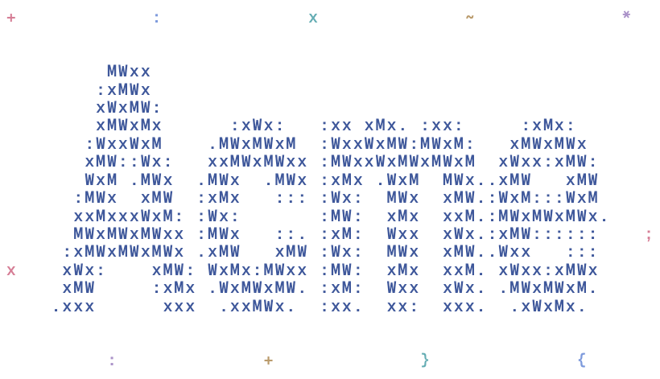

# Skills

Practical agent skills, each shipped as a self-contained folder under `skills/`.

The first skill turns a name into a transparent ASCII repair animation. This example was generated from “Acme”:

<picture>
  <source media="(prefers-reduced-motion: reduce) and (prefers-color-scheme: dark)" srcset="examples/acme/media/wordmark-dark-static.png">
  <source media="(prefers-reduced-motion: reduce)" srcset="examples/acme/media/wordmark-light-static.png">
  <source media="(prefers-color-scheme: dark)" srcset="examples/acme/media/wordmark-dark.gif">
  <source media="(prefers-color-scheme: light)" srcset="examples/acme/media/wordmark-light.gif">
  
</picture>

| Skill | What it makes |
| --- | --- |
| [animate-ascii-wordmark](skills/animate-ascii-wordmark/SKILL.md) | A readable ASCII wordmark with a looping `@` chase, a standalone web preview, and theme-aware GIFs and static images. |

## Install a skill

Clone or download this repository, then copy the skill folder into your agent's skill directory. For Codex:

```bash
git clone https://github.com/philspaces/skills.git
cd skills
```

Run the following from the repository root:

```bash
mkdir -p ~/.codex/skills
if [ -e ~/.codex/skills/animate-ascii-wordmark ]; then
  echo "An installation already exists; review it before replacing it."
else
  cp -R skills/animate-ascii-wordmark ~/.codex/skills/
fi
```

For another agent, use its documented skill directory or provide the path to the skill's `SKILL.md`. The folder includes its scripts, references, fonts, and browser runtime; keep them together.

Start a new agent session and ask:

> Use $animate-ascii-wordmark to make an animated wordmark for “Acme”.

The text is enough to get started. The skill supplies the animation behavior and produces both dark and light exports by default. Short names work best; the bundled fonts cover Latin alphabets, including Vietnamese, digits, and punctuation. Text is limited to 40 characters.

## Run the wordmark tools directly

Use Node.js 22 or newer. Install dependencies from the repository root:

```bash
npm ci
npx playwright install chromium
```

A copied skill can install its own dependencies with `npm install` inside its folder. GIF export also requires `ffmpeg` on your `PATH`. Choose a fresh output folder for each generation and export; both commands require a new destination.

```bash
cd skills/animate-ascii-wordmark
node scripts/generate.mjs --text "Acme" --out /absolute/path/to/acme
python3 -m http.server --directory /absolute/path/to/acme 8000
```

Open `http://localhost:8000`. In another terminal, export the animation:

```bash
node scripts/export.mjs --input /absolute/path/to/acme --out /absolute/path/to/acme/media
```

The generated site is self-contained and uses no React. Export produces dark and light GIFs, static PNG fallbacks, and `export.json` with validation results. See the [skill instructions](skills/animate-ascii-wordmark/SKILL.md) for options and [integration reference](skills/animate-ascii-wordmark/references/integration.md) for website, React, and GitHub usage.

## Repository layout

```text
skills/
  animate-ascii-wordmark/
    SKILL.md
    agents/
    scripts/
    references/
    assets/
```

New skills get their own folder under `skills/`; each includes its own runtime and resources. See [CONTRIBUTING.md](CONTRIBUTING.md) for contribution and validation guidance.

## License

Code and documentation are licensed under the [MIT License](LICENSE). Bundled Geist and Geist Mono fonts use the SIL Open Font License; their notices are included in [assets/fonts](skills/animate-ascii-wordmark/assets/fonts/NOTICE.md) and preserved in generated output.
