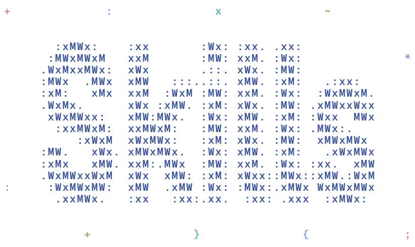

# Skills

Open-source skills for coding agents, by Phi Long Nguyen.

<picture>
  <source media="(prefers-reduced-motion: reduce) and (prefers-color-scheme: dark)" srcset="examples/skills/media/wordmark-dark-static.png">
  <source media="(prefers-reduced-motion: reduce)" srcset="examples/skills/media/wordmark-light-static.png">
  <source media="(prefers-color-scheme: dark)" srcset="examples/skills/media/wordmark-dark.gif">
  <source media="(prefers-color-scheme: light)" srcset="examples/skills/media/wordmark-light.gif">
  
</picture>

## Get started

Ask your coding agent:

> Install the animate-ascii-wordmark skill from https://github.com/philspaces/skills for this project.

Then tell it what you want to make:

> Use animate-ascii-wordmark to animate “Your Brand” with a transparent background, for my website and GitHub README.

Use a coding agent with access to local files and tools. The skill guides the agent through setup, generation, and export. If a newly installed skill is not available yet, start a new agent session.

### Prefer a one-line install?

```bash
npx skills add philspaces/skills --skill animate-ascii-wordmark
```

Run it in your project and choose your agent when prompted. See the [skills CLI](https://github.com/vercel-labs/skills#install-a-skill) for installation options.

## Available skills

| Skill | What to ask for |
| --- | --- |
| [animate-ascii-wordmark](https://skills.sh/philspaces/skills/animate-ascii-wordmark) | Animate a name as a transparent ASCII wordmark: an `@` cursor repairs wandering characters in a seamless loop. Includes web animation, light/dark GIFs, and static PNGs. |
| [drawio-system-design](skills/drawio-system-design/SKILL.md) | Build editable draw.io architecture diagrams from code and infrastructure, using service icons, traced flows, evidence and clearly marked defects. |

To install the draw.io skill:

```bash
npx skills add philspaces/skills --skill drawio-system-design
```

This does not mean a skills.sh listing is already indexed; the catalog links to the local skill until a public listing is verified.

For architecture work, ask your agent:

> Install drawio-system-design from https://github.com/philspaces/skills, then diagram this codebase and infrastructure with service icons. Show evidenced defects and unresolved assumptions separately.

The wordmark above was generated from “Skills”. Short names work best; the bundled fonts support Latin alphabets, including Vietnamese.

## Contributing

Each skill lives in its own folder under `skills/`. See [CONTRIBUTING.md](CONTRIBUTING.md) to add a skill, improve one, or run the development checks.

## License

Code and documentation are licensed under the [MIT License](LICENSE). Bundled Geist and Geist Mono fonts use the SIL Open Font License; their [notices](skills/animate-ascii-wordmark/assets/fonts/NOTICE.md) stay with generated output.
